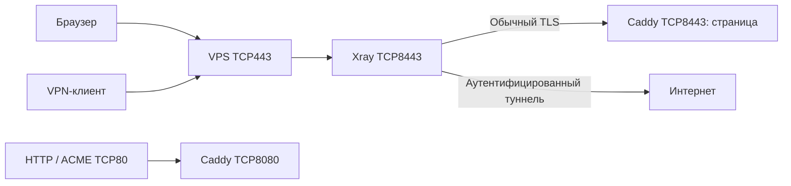

# Как устроены infra и запуск узла

`infra` — описание ресурсов. Скрипты в `tools` подготавливают настройки и вызывают Terraform. Xray и Caddy затем работают на выбранном Docker-сервере независимо от управляющего ноутбука. Для локальной проверки Docker находится внутри Colima на Mac; для production используется Docker на существующем VPS через SSH.

## Один источник параметров

`npm run init` читает параметры в порядке: аргументы команды → переменные процесса `VPN_*` → выбранный `.env` → сохранённый узел → значения по умолчанию. `.env` разбирается как данные, без `source`, `eval` и выполнения `$()`.

Примеры: [production](../.env.example), [локальная среда](../deploy/local.env.example). Файлы с реальными настройками не коммитятся; настоящие ключи генерируются в `runtime/` и вообще не задаются через `.env`.

| Настройка | Куда попадает |
| --- | --- |
| `VPN_NODE` | Имя узла, префикс Docker-ресурсов, каталог его state |
| `VPN_DOMAIN` | REALITY `serverNames`, клиентский SNI, имя сайта Caddy и сертификат |
| `VPN_ADDRESS` | Адрес подключения в клиентских ссылках: IP или доменное имя |
| `VPN_DOCKER_HOST` | Адрес управления: `ssh://user@host`, передаваемый Docker CLI и Terraform-провайдеру |
| `VPN_PORT`, `VPN_HTTP_PORT` | Публикуемые порты Docker-хоста; в production обычно 443 и 80 |
| `VPN_BIND_ADDRESS` | Интерфейс публикации портов: локально только `127.0.0.1`, публично обычно `0.0.0.0` |
| `VPN_DNS_SERVERS` | DNS-резолверы контейнеров через Terraform `dns_servers` → Docker `dns` |
| `VPN_VM_HOSTNAME` | Имя локальной VM через параметр `hostname` профиля Colima |
| `VPN_VM_DNS_SERVERS` | DNS-резолверы самой локальной VM через параметр `network.dns` профиля Colima |
| `VPN_XRAY_MEMORY_MB`, `VPN_CADDY_MEMORY_MB` | Верхние пределы памяти контейнеров в МиБ |
| `VPN_XRAY_CPUS`, `VPN_CADDY_CPUS` | Верхние пределы доступного CPU |

Это три разных понятия DNS: публичная запись `A/AAAA` у регистратора, резолвер внутри VM и резолвер контейнера. Публичная запись направляет пользователей на VPS. Резолвер отвечает, куда VM или контейнер обращается для разрешения имён. Изменение резолвера не создаёт публичную запись. `VPN_VM_HOSTNAME` тоже не регистрирует домен: это внутреннее имя Linux-машины.

Сейчас VPS уже существует, поэтому его SSH-адрес вводится оператором. Модуля создания Timeweb VPS и DNS-записей в проекте нет. Когда он появится, его outputs с IP/SSH-адресом можно будет автоматически передавать этому модулю. Покупаемый домен всё равно остаётся входным параметром.

VM-настройки действуют только для локальной Colima и сохраняются в `runtime/<node>/vm.json`. Они не меняют hostname или `/etc/resolv.conf` удалённого VPS. Все локальные узлы используют одну VM `config-v`, поэтому изменение её параметров может затронуть другие локальные узлы. Работающая VM автоматически не перезагружается: если параметры изменились, команда попросит сначала явно остановить её.

## infra/colima/config-v.yaml

Это YAML для Colima, а не Terraform. Шаблон создаёт локальную Linux VM: 2 CPU, 2 ГБ RAM, виртуальный диск 20 ГБ, `runtime: docker`, `vmType: vz`.

- `mounts: null` означает отсутствие общих каталогов Mac. В Colima `mounts: []` имеет другую семантику — стандартные общие каталоги, поэтому такая замена запрещена проверкой.
- `forwardAgent: false` не передаёт SSH-агент в VM.
- `sshConfig: false` и `autoActivate: false` сохраняют глобальную конфигурацию SSH/Docker отдельно от профиля проекта.
- `network.address: false`, `hostAddresses: false` ограничивают сетевые интеграции с хостом.
- Kubernetes выключен.

Colima при запуске разворачивает короткий YAML в полный файл с параметрами по умолчанию. `tools/colima.mjs` разбирает YAML настоящим парсером и проверяет значения, а не сравнивает текст построчно. Небезопасный или неизвестный профиль не перезаписывается молча. Проверяются также дополнительные provision-скрипты и настройки Docker, которые могли бы ослабить изоляцию.

## infra/node/versions.tf

Объявляет Terraform `>= 1.6.0, < 2.0.0` и Docker provider `kreuzwerker/docker` версии `4.6.0`. Провайдер — плагин, который переводит Terraform-ресурсы в вызовы Docker API.

Сам адрес Docker здесь отсутствует намеренно. Его задаёт сгенерированная корневая конфигурация конкретного узла; один и тот же модуль можно использовать с Colima или удалённым VPS.

## infra/node/.terraform.lock.hcl

Фиксирует выбранную версию провайдера и контрольные суммы его пакетов. Скрипт копирует lock-файл в каталог Terraform конкретного узла и запускает `terraform init -lockfile=readonly`.

Lock-файл провайдера не закрепляет все Docker-образы. Xray отдельно закреплён по SHA256 digest, Caddy — по полному тегу версии. Для неизменного содержимого Caddy нужно отдельно закрепить digest его образа.

## infra/node/variables.tf

Объявляет входные данные модуля, их типы, значения по умолчанию и проверки. Например, память Xray по умолчанию 256 МиБ, Caddy — 128 МиБ; CPU соответственно 1 и 0.5. DNS-резолверы по умолчанию пустые: используются настройки Docker.

Порты должны быть целыми числами 1–65535 и различаться. Память — целые МиБ не меньше 64; CPU — положительное число; резолверы — IPv4/IPv6-адреса. Архитектура контейнеров определяется по выбранному Docker daemon, а не по ноутбуку, на котором запущен Terraform.

Название файла условное: Terraform читает все `.tf` в каталоге вместе. Переменная становится значением `var.<имя>`, локальное вычисление — `local.<имя>`.

## infra/node/main.tf

Описывает желаемое состояние ресурсов, а не последовательность shell-команд. Например:

```hcl
resource "docker_container" "xray" {
  name    = "${local.prefix}-xray"
  image   = docker_image.xray.image_id
  user    = "65532:65532"
  restart = "unless-stopped"
  memory  = var.xray_memory_mb
  # Другие поля есть в полном main.tf.
}
```

`docker_container` — тип ресурса; `xray` — его имя внутри Terraform; `name` — настоящее имя контейнера. Ссылка на `docker_image.xray.image_id` создаёт зависимость: прежде чем запускать контейнер, нужен образ. `depends_on` у Xray требует сначала создать контейнер Caddy; это не проверка готовности HTTPS.

В начале `locals` вычисляет префикс `config-v-<node>`, имена конфигурационных томов и хэш исходников образа Caddy. Затем объявлены восемь ресурсов:

1. `terraform_data.config_revision` — метка содержимого конфигурации, запускающая пересоздание контейнеров при изменении.
2. `docker_network.node` — отдельная bridge-сеть. Она имеет выход в интернет; `internal = false` не означает публикацию всех портов наружу.
3. `docker_volume.caddy_data` — постоянное хранилище Caddy, включая сертификаты.
4. `docker_volume.caddy_runtime` — постоянные runtime-данные Caddy.
5. `docker_image.xray` — закреплённый образ Xray.
6. `docker_image.caddy` — образ Caddy, собранный по Dockerfile проекта на выбранном Docker daemon.
7. `docker_container.caddy` — сайт и HTTPS-сертификаты.
8. `docker_container.xray` — VPN и входная точка HTTPS.

Два конфигурационных тома Xray/Caddy создаёт подготовительный `seed`, они не входят в эти восемь ресурсов. Xray получает `xray.json`, Caddy получает только `Caddyfile`. Тома подключаются только для чтения; приватный ключ REALITY не передаётся Caddy.

У обоих контейнеров UID/GID `65532`, `cap_drop=ALL`, `no-new-privileges`, read-only корневая файловая система. Для временных файлов есть ограниченный tmpfs. Хостовые каталоги и Docker socket внутрь не передаются. Память/CPU ограничиваются, stdout/stderr-логи ротируются. Эти настройки уменьшают права процессов, но контейнеры по-прежнему разделяют ядро Linux VM/хоста.



Внутренний HTTPS Caddy отдельно наружу не публикуется. Порт 80 нужен для HTTP-01 получения сертификата: если изменить публикуемый HTTP-порт, требуется внешняя переадресация TCP80 на него. Локально публикуются только `127.0.0.1:8443` и `127.0.0.1:8080`.

`prevent_destroy` защищает два постоянных тома Caddy от удаления Terraform, пока соответствующие lifecycle-правила присутствуют в конфигурации. Это не резервная копия и не защита от ручного `docker volume rm` или потери VPS.

## infra/node/caddy-image/Dockerfile и .dockerignore

Dockerfile использует официальный Caddy Alpine. Он удаляет capability привязки к низким портам из бинарного файла и подготавливает каталоги `/data`, `/config` для UID 65532. Сам Caddy слушает высокие порты 8080/8443; внешние 80/443 публикует Docker.

`.dockerignore` разрешает в контексте сборки только Dockerfile и сам ignore-файл. Ключи, клиентские профили и остальной репозиторий в образ не попадают.

## infra/node/outputs.tf

Возвращает имя узла, публикуемые порты, названия контейнеров и томов. Это справочные результаты для инструментов управления. `output` ничего сам не запускает и не проверяет доступность VPN. Ключи и клиентские ссылки в outputs не выводятся.

## Сгенерированный корень и state

Перед планированием `tools/vpn.mjs` создаёт `runtime/<node>/terraform/main.tf.json`. Это полноценный JSON-синтаксис Terraform: в нём Docker provider с конкретным endpoint, вызов модуля `../../../infra/node` и несекретные параметры. Файл генерируется автоматически, ручные изменения будут обнаружены или заменены при следующем plan.

В том же каталоге находятся `.terraform/`, lock-файл, сохранённый `deployment.tfplan` и `terraform.tfstate`. State связывает адреса ресурсов Terraform с настоящими Docker ID. Это локальный backend, отдельный для каждого узла. Старый state нельзя переносить на другой VPS как описание новых ресурсов. При смене daemon создаётся новый узел; `init` запрещает менять endpoint существующего узла.

## tools и полный init

- `settings.mjs`: параметры CLI, `.env`, вопросы о недостающих значениях в интерактивном терминале.
- `config.mjs`: создание/проверка ключей и конфигов; обновление существующего узла с сохранением пользователей, ключей и short ID; подготовка несекретных Terraform-параметров.
- `colima.mjs`: проверка профиля, запуск остановленной локальной VM и передача её hostname/DNS.
- `docker.mjs`: передача файлов через stdin во временные тома, проверка кандидатных конфигураций настоящими Xray/Caddy и публикация проверенных файлов.
- `vpn.mjs`: отдельные команды validate/seed/plan/apply/status; после успешного apply сохраняет его параметры в `applied.json`.
- `lifecycle.mjs`: собирает перечисленные действия в один init и предоставляет перезапуски.

```text
init
  → параметры и сохранённый узел
  → генерация/обновление конфигурации без смены ключей
  → validate
  → проверка Terraform/Docker, запуск Colima только для local
  → seed → plan → apply → status
  → реальный smoke-тест туннеля для local
```

По умолчанию init применяет показанный план. `--prepare-only` сохраняет конфигурацию без запуска VM/контейнеров. `--plan-only` готовит конфигурационные тома и сохраняет план, но не вызывает apply. Он не является полностью read-only командой: seed уже записывает проверенные файлы в тома.

Повторный init сохраняет ключи/UUID. Параметры берутся из сохранённого узла, если их не переопределили. Изменение домена меняет SNI/сайт; адрес подключения меняется только при явном `VPN_ADDRESS`/`--address`. После изменения адреса/SNI/порта нужно раздать обновлённые ссылки. Добавление устройств по-прежнему выполняется через `vpn:add-client`, затем полный init.

## Перезапуски

```sh
npm run restart:vpn -- --node de-main
npm run restart:client -- --node de-main
npm run restart:all -- --node de-main
npm run restart:back -- --node de-main
```

`vpn` перезапускает только Xray; `client` — Caddy, который обслуживает сайт; `all` — Caddy и Xray. `client` здесь не означает мобильное VPN-приложение и не управляет процессом Vite dev server на Mac. Сайт пока является страницей-заглушкой Caddy.

`back` зарезервирован для будущего API-бэкенда и пока завершится с понятным сообщением о его отсутствии. Скрипты `tools/` не являются постоянно работающим backend-сервисом. `restart` без уточнения эквивалентен `restart:all`.

Перезапуск использует сохранённый endpoint и параметры последнего успешного apply. Изменённые настройки сначала требуется применить через init. Проверяется содержимое конфигурационных томов и принадлежность выбранных контейнеров узлу; команды обращаются к точным Docker ID. При `all` проверяются оба контейнера до первого перезапуска. Ключи/сертификаты и state сохраняются. ОС VPS и сама VM не перезагружаются; текущие соединения выбранного сервиса могут оборваться.

Команды init/restart одного узла защищены локальной блокировкой `runtime/.locks/<node>`. Низкоуровневые команды и операции с другого компьютера этой блокировкой не охватываются. После аварийного завершения проверяйте, что процесс действительно закончил работу, прежде чем удалять оставшийся каталог блокировки.

## Что остаётся отдельной работой

Установка среды исполнения на удалённый VPS, создание VPS/DNS через API, off-site backup и автоматическое переключение клиентов на резервный узел пока не автоматизированы. `init` проверяет готовность Docker по SSH, но не устанавливает rootful Docker и не меняет ОС удалённого сервера. `restart` и политика `unless-stopped` не лечат блокировку IP или потерю сети. Для production нужны настоящий домен, доступный TCP80 для сертификата и проверки с реальных сетей семьи.
